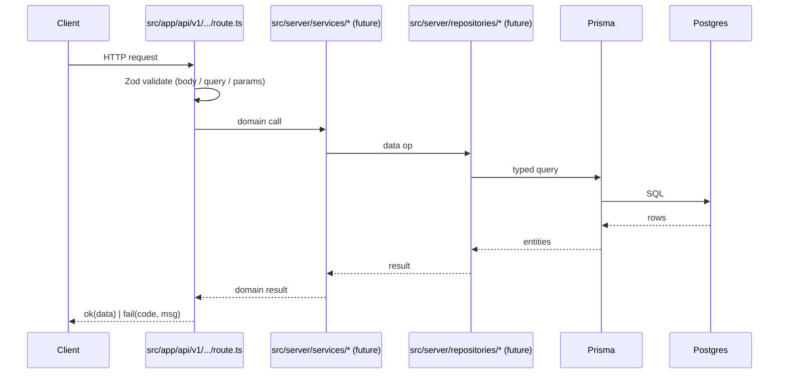

# System Architecture

## 1. Overview

Louve is a Next.js (App Router) storefront for editorial fine jewellery.
It renders marketing / discovery views (Home, Collection, PDP, Store
list, immersive 3D store, Account) and exposes a small versioned HTTP
API under `/api/v1`. A PostgreSQL database managed by Prisma is wired
in but holds only a placeholder `HealthProbe` model today — real domain
models are planned.

## 2. Stack

| Layer | Technology |
|---|---|
| Framework | Next.js 16 (App Router, Turbopack) |
| UI | React 19, hand-written CSS, custom fonts (Neue Haas, Editorial New) |
| 3D | three.js, `@react-three/fiber`, `@react-three/drei` |
| TypeScript | 6, strict |
| Runtime validation | Zod 4 |
| Server-only guard | `server-only` |
| Database | PostgreSQL 14+ |
| ORM | Prisma 6 |
| Lint | ESLint (next/core-web-vitals, next/typescript) + oxlint (legacy) |
| Package manager | npm (lockfile v3) |

## 3. Frontend architecture

- **Routing:** App Router segments under `src/app/**`. Each route's
  `page.tsx` is a Server Component that composes metadata and mounts a
  per-view client wrapper (`src/views/<name>/<Name>View.tsx`).
- **Chrome:** `src/components/layout/AppShell.tsx` provides the shared
  Header + PopularSearches around every view.
- **Navigation:** `src/lib/nav/useAppNav.ts` is a thin shim over
  `next/navigation` that keeps the legacy `<Header />` callback contract
  working.
- **Static content:** `src/data/*` holds hand-authored product, store,
  and nav data as plain TypeScript modules.
- **Styling:** global CSS and tokens live in `src/styles/*`, loaded once
  from `src/app/layout.tsx` in the original Vite order.
- **Browser-persistent state:** `src/lib/{session,account,wishlist}.ts`
  use `localStorage` behind small typed APIs. These are placeholders
  until a real server-backed implementation is built.

## 4. Backend architecture

- **Route handlers** live under `src/app/api/v1/**/route.ts`.
- **Shared response envelope** and error mapping:
  [`src/lib/http/response.ts`](../../src/lib/http/response.ts),
  [`src/lib/errors/app-error.ts`](../../src/lib/errors/app-error.ts).
- **Server env** (`DATABASE_URL`, `NODE_ENV`): validated by
  [`src/lib/env/server.ts`](../../src/lib/env/server.ts) at first use.
- **Prisma client:** lazy singleton in
  [`src/server/db/prisma.ts`](../../src/server/db/prisma.ts), isolated
  from client bundles via `server-only`.
- **Repositories / services / auth / security:** reserved folders under
  `src/server/`; empty today, documented for future growth.

## 5. Server / client boundary

```
[Server-only — never bundled to the browser]
  src/lib/env/server.ts        (process.env, Zod)
  src/server/**                (Prisma, future repos/services)

[Shared — safe both sides]
  src/lib/errors/**
  src/lib/http/response.ts     (uses NextResponse; safe in route handlers)
  src/types/**, src/schemas/**, src/constants/**

[Client — "use client" required to use state/effects]
  src/components/**            (except pure presentational SC-safe ones)
  src/views/**/*View.tsx
  src/hooks/**
  src/lib/nav/useAppNav.ts
```

The `server-only` import in server modules fails the build at the first
accidental client import, giving a hard guarantee alongside the
documented rule.

## 6. Rendering strategy

See [`RENDERING_STRATEGY.md`](RENDERING_STRATEGY.md).

Summary: pages are Server Components by default; client interactivity is
pushed into `*View.tsx` wrappers; `/pdp/[productId]` and
`/stores/[storeId]` are per-request dynamic because of their params; the
rest are statically prerendered.

## 7. API request lifecycle



Today the Service and Repository layers are empty; `/api/v1/db/health`
calls `checkDatabaseConnection()` directly in `src/server/db/prisma.ts`.
That is acceptable for a probe but not for business endpoints.

## 8. State management

| Scope | Implementation |
|---|---|
| URL state | App Router segments + `useSearchParams()` (`/stores/[id]?collection=1`) |
| Per-view local state | React `useState`/`useEffect` inside `*View.tsx` + page components |
| Cross-tab persistent | `localStorage` wrappers in `src/lib/{session,account,wishlist}.ts` with a custom `WISHLIST_EVENT` for in-page syncing |
| Server state | None yet (no real API consumers from the UI) |

No external state library is used.

## 9. Authentication / authorization

**Not implemented.** `src/lib/account.ts` is a demo store with a seeded
local account; `AuthPanel` is UI only. Any new privileged route or
mutation must introduce proper authentication before shipping. See
[`../security/SECURITY_GUIDELINES.md`](../security/SECURITY_GUIDELINES.md).

## 10. Error handling

- Expected failures → `throw new AppError(code, message, details?)`.
- Zod failures → wrapped automatically by `toErrorResponse`.
- Unknown failures → surfaced as `INTERNAL_ERROR` with no leaked
  details.
- Route-level UI errors → `src/app/error.tsx`.
- Unknown URLs → `src/app/not-found.tsx`.

## 11. Logging / observability

Not configured. Development uses `console.error` guarded by
`NODE_ENV !== "production"`. A real observability integration is
planned but not yet wired.

## 12. Data flow

```mermaid
flowchart LR
  subgraph Browser
    V[View / Component] -- useAppNav --> N[next/navigation]
    V -- fetch (future) --> API
    V -- read/write --> LS[(localStorage)]
  end
  subgraph Server
    API[/api/v1/* route handler/] --> S[server services (future)]
    S --> R[repositories (future)]
    R --> P[Prisma]
    P --> DB[(PostgreSQL)]
  end
```

## 13. External integrations

None currently. No analytics, no payments, no CMS, no CDN beyond the
Next.js static output.

## 14. Current limitations

- Domain schema is a single `HealthProbe` placeholder.
- No tests exist.
- No authentication.
- `localStorage` is the only persistence for session/account/wishlist.
- No deployment target chosen.

## 15. Implementation status

| Area | Status |
|---|---|
| App Router routes (all views) | Implemented & verified |
| `/api/v1/health` | Implemented & verified |
| `/api/v1/db/health` | Implemented & verified (returns 503 without DB) |
| Prisma schema | Minimal, verified via `prisma validate` |
| Prisma migrations | **Planned** — none created |
| Authentication | **Planned** |
| Server services / repositories | **Planned** (folders reserved) |
| Automated tests | **Planned** |
| CI / deployment | **Planned** |
